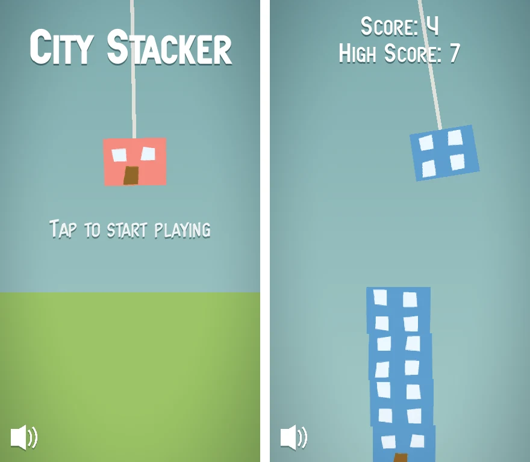

# City Stacker

Mobile arcade game where you build your city by stacking the houses yourself.

A house swings on the crane, tap to drop it onto your building. Every floor that lands raises your score, but if a
house misses the stack and hits the ground, or the building tips over the edge, the game is over.



Play the original version on [itch.io](https://flipflogames.itch.io/city-stacker).

## Running the game

The game is made with [Godot 4.7](https://godotengine.org/download) using the Compatibility renderer, so it runs on
desktop, web and mobile.

1. Open `project.godot` in the Godot editor.
2. Press <kbd>F5</kbd> to play.

| Input                       | Action          |
| --------------------------- | --------------- |
| Tap / left click / space    | Drop the house  |
| Escape / Android back       | Quit            |

## Project structure

```
assets/      fonts, sprites and audio
resources/   config resources, color palette and ui theme
scenes/      game, hud, house and background music scenes
scripts/
  audio/     background music autoload
  config/    config resource classes (CraneConfig, HouseConfig, CameraConfig, Palette)
  core/      Game root, GameState autoload, unit conversion
  crane/     Crane and House
  ui/        Hud, SmallCapsLabel, MuteButton
  world/     GameCamera, Ground, BoundaryArea, SkyBackground
shaders/     sky gradient and vignette
```

`Game` is the root of the main scene. It handles input and the score and connects its children through signals, the
children never reach up the tree. Gameplay values like the rope length, swing angle, house physics and camera
behaviour live in the resources in `resources/config/` and can be tweaked in the inspector. Positions are configured in
world units like in the original Unity version: one unit is the height of a floor and 10 units fill the screen height.

High score and mute setting are saved to `user://save.cfg`.

## Development

GDScript is statically typed, untyped declarations and unsafe access are treated as errors in the project settings.
Formatting and linting use [gdtoolkit](https://github.com/Scony/godot-gdscript-toolkit) and run in CI:

```sh
pip install -r requirements-dev.txt
gdformat --line-length 120 .
gdlint .
```

`scenes/test/stack_test.tscn` starts with a stack of houses already in place, stacked almost perfectly with seeded
random offsets, to check how stable tall buildings are. Open it and press <kbd>F6</kbd> to watch, or run it headless
and read the printed result (exit code 1 if the stack moved):

```sh
godot --headless res://scenes/test/stack_test.tscn -- --houses=10 --seed=3 --duration=10
```

Other options are `--offset` and `--rotation` for the random placement and `--ticks` and `--iterations` to try
different physics settings.

All assets are stored directly in git, Git LFS is not used. The whole `assets/` folder is about 400 KB, the music is
an Ogg Vorbis file.

## History

City Stacker was originally made with Unity in 2021. The Unity project, including the ML-Agents experiment that trained
an AI to play the game, is still available in the git history before the Godot port.

## License

See [LICENSE](LICENSE).
